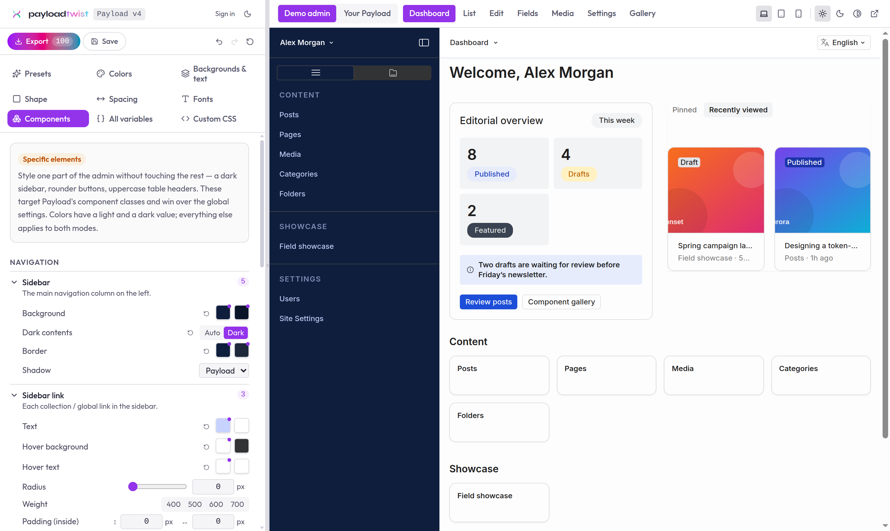

<p align="center">
  
</p>

<h1 align="center">payloadtwist</h1>

<p align="center">
  A visual theme editor for the <a href="https://payloadcms.com">Payload</a> <strong>v4</strong> admin.<br/>
  Change colors, backgrounds, corners, spacing, fonts or a single component on a live admin,<br/>
  with every control explained — then export clean CSS or an installable theme.<br/><br/>
  Inspired by <a href="https://tweakcn.com">tweakcn</a> — the shadcn/ui theme editor.
</p>

<p align="center">
  
</p>

> payloadtwist targets **Payload v4** (currently `4.0.0-beta.10`). Payload v4 replaced the v3
> `--theme-*` / `--color-base-*` variables and SCSS with `--ramp-*` palettes, semantic `--color-*`
> roles and plain, layered CSS. v3 is not supported.

## Features

- **A real Payload v4 admin as the preview.** It has a dashboard, lists, edit views, drawers, media,
  every field type, every Lexical rich-text node and a component gallery, all with demo content.
  Or connect **your own** Payload v4 admin.
- **Every control explained.** Each setting and each of Payload's variables has a plain-language
  description. Hover one and the components it affects are outlined in the preview.
- **Exact control.** Presets are starting points. Every value has a slider and a typed input.
- **Light, dark and enhanced contrast.** Preview all three, plus desktop/tablet/mobile widths,
  with undo/redo.
- **Export.** Download a `custom.css` with no `!important` (Payload's styles are layered), a
  [`payload-admin-ui-themes`](https://github.com/zubricks/payload-admin-ui-themes) theme package
  (a `.zip` with the CSS, a provider, a manifest and an install README), or JSON.
- **Proven export.** The demo admin runs payloadtwist's own presets as exported packages. Open
  `/preview` → account → Settings → Admin theme to try them.

### The editor tabs

| Tab | Scope | What it changes |
|---|---|---|
| **Presets** | whole theme | Twelve built-in themes, your saved presets (save, update, copy a share link) and themes the community shared (also browsable and rateable at `/presets`) |
| **Colors** | global | Seed colors (brand, neutral, success, warning, danger) regenerate Payload's color scales; fine-tune any step |
| **Backgrounds & text** | global | Page and panel backgrounds, text, borders, focus ring and form fields in light and dark, a tint/depth control, and WCAG readability checks |
| **Shape** | global | Overall roundness or each corner size, border strength and width, and shadow styles or a hand-made shadow per level (offset, blur, spread, color, opacity) |
| **Spacing** | global | Spacing scale, page padding, field gaps and padding, control heights, sidebar widths, every spacing step |
| **Fonts** | global | Google Fonts for body, headings and code, a type scale, and size / line height / weight / letter spacing per text level |
| **Components** | one element | Colors, radius, shadow, weight, case, letter spacing, padding and margin on specific parts: sidebar, active link, top bar, buttons, cards, widgets, table header and cells, inputs, labels… |
| **All variables** | raw | All 484 Payload v4 variables, searchable by name or by what they do, per mode |
| **Custom CSS** | raw | Extra CSS appended to the export |

Global tabs set Payload's shared variables, so the whole admin follows. **Components** targets
Payload's component classes and wins over the global settings.

## Quick start

Requirements: Node 24.22+, pnpm 10, PostgreSQL (for accounts).

```bash
git clone https://github.com/elghaied/payloadtwist.git
cd payloadtwist
pnpm install
cp apps/web/.env.example apps/web/.env   # set AUTH_DATABASE_URL and BETTER_AUTH_SECRET
pnpm dev
```

Open [http://localhost:3000/editor](http://localhost:3000/editor). The demo admin lives at
[`/preview`](http://localhost:3000/preview).

## How it works

```
apps/web/src/
├── payload-theme/         theme model, ramp generator, CSS output — all pure, unit-tested
│   ├── payload-theme-schema.json   ← generated from @payloadcms/ui (pnpm extract-payload-theme):
│   │                        every token, its light/dark value and which components use it
│   ├── theme.ts           ThemeConfig + reducers + parseTheme (validation at every boundary)
│   ├── ramps.ts           seed color → Payload ramp families
│   ├── controls.ts        roundness, spacing, type levels, shadows, surfaces → tokens
│   ├── components.ts      per-component styles on Payload's BEM classes
│   ├── descriptions.ts    plain-language descriptions + preview highlight selectors
│   └── css.ts             custom.css / theme package builder
├── payload/               the embedded demo Payload v4 (in-memory SQLite, read-only, seeded)
├── app/(payload)/         Payload's admin at /preview and REST at /preview-api
├── app/(frontend)/        landing, editor, presets, dashboard, auth
└── store/editor-store.ts  zustand store with undo/redo
```

The editor posts the generated CSS to the preview iframe; a small provider inside the admin
(`PreviewBridge`, or the `PayloadTwistBridge` users copy into their own project) writes it into a
`<style>` tag and drives Payload's own theme hooks for light/dark and contrast. The same bridge
outlines the components a hovered control affects. Both directions check origins.

## Development

```bash
pnpm dev          # dev server
pnpm build        # production build
pnpm lint
pnpm typecheck
pnpm --filter @payloadtwist/web test:int   # unit tests (vitest)
pnpm --filter @payloadtwist/web test:e2e   # end-to-end (playwright)
```

| Script (apps/web) | Description |
|---|---|
| `extract-payload-theme` | Regenerate the token schema from the installed `@payloadcms/ui`. Run after every Payload upgrade. |
| `generate:importmap` | Regenerate the demo admin's import map after adding admin components. |
| `payload migrate:create` | Regenerate the demo DB migration after changing demo collections (production builds the in-memory DB from it). |
| `generate:admin-themes` | Re-export the built-in presets into `src/admin-themes/` (a test fails if they drift). |
| `fetch-google-fonts` | Refresh the Google Fonts catalog. |
| `db:generate` / `db:migrate` | Auth database migrations (Drizzle). |

### Docker

```bash
docker compose up
```

App + PostgreSQL. The image runs on `node:24-trixie-slim` without npm/corepack.

## License

MIT
